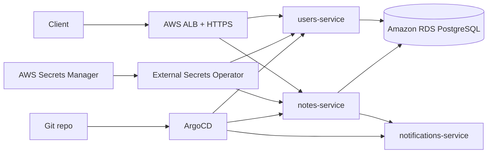

# Platform v2: Production-Style DevOps Platform on AWS

A 30-day build-in-public project. Three FastAPI microservices go from local development to a production-style platform on AWS EKS, using Terraform, GitOps, DevSecOps and SRE practices.

> Follow-up to my first 30-day sprint: [Notes-API-Kubernetes](https://github.com/Raani1011/Notes-API-Kubernetes), where I deployed a single API on EKS with Terraform, GitHub Actions, Prometheus/Grafana and ArgoCD.

---

## Target Architecture



- **users-service** handles registration and login, and issues JWT tokens
- **notes-service** verifies the JWT and manages each user's notes
- **notifications-service** receives events when notes change
- All three services are deployed by **ArgoCD** from Git. Database credentials come from **AWS Secrets Manager** through **External Secrets Operator**, so no secrets are stored in Git.

---

## Tech Stack

| Area | Tools |
|------|-------|
| Backend | Python, FastAPI, SQLAlchemy, PostgreSQL, JWT, bcrypt |
| Containers | Docker, Docker Compose |
| Orchestration | Kubernetes (minikube locally, AWS EKS in the cloud), Helm |
| Infrastructure as Code | Terraform (VPC, EKS, RDS) |
| GitOps | ArgoCD (app-of-apps), Argo Rollouts |
| CI/CD | GitLab CI |
| Security | Trivy, Checkov, cosign, Kyverno |
| Observability | Prometheus, Grafana, OpenTelemetry, Tempo |
| Scaling and Cost | Karpenter, spot instances, OpenCost |

---

## Roadmap

### Week 1: Build and AWS Foundation
- [x] Day 1: Repo setup, AWS budget alert, users-service (register, login, JWT, health)
- [x] Day 2: notes-service (JWT-protected CRUD)
- [x] Day 3: notifications-service + Docker Compose with PostgreSQL
- [ ] Day 4: Terraform for VPC, EKS (spot nodes) and RDS
- [ ] Day 5: Secrets Manager + External Secrets Operator
- [ ] Day 6: Reusable Helm chart + ArgoCD app-of-apps
- [ ] Day 7: ALB Ingress, custom domain, end-to-end test

### Week 2: DevSecOps with GitLab CI
- [ ] Day 8: Local minikube + ArgoCD, repo moved to GitLab
- [ ] Day 9: GitLab CI build, test and push
- [ ] Day 10: Trivy image scanning
- [ ] Day 11: Checkov Terraform scanning
- [ ] Day 12: cosign image signing
- [ ] Day 13: Kyverno policies
- [ ] Day 14: Block unsigned images with Kyverno

### Week 3: SRE and Observability
- [ ] Days 15-16: Prometheus metrics, SLOs and burn-rate alerts
- [ ] Days 17-18: Distributed tracing with OpenTelemetry + Tempo
- [ ] Days 19-20: Argo Rollouts canary with automatic rollback
- [ ] Days 21-22: Chaos testing + written postmortem

### Week 4: Scale, Cost and Polish
- [ ] Days 23-24: Karpenter with spot instances
- [ ] Days 25-27: GitOps cleanup, documentation, architecture diagrams
- [ ] Days 28-30: Final full deployment on EKS, demo, write-up

---

## Repository Structure

```
platform-v2/
├── services/
│   ├── users-service/          # Auth: register, login, JWT
│   ├── notes-service/          # Notes CRUD (JWT-protected)
│   └── notifications-service/  # Event notifications
├── terraform/                  # AWS infrastructure (VPC, EKS, RDS)
├── gitops/                     # Helm chart + ArgoCD manifests
└── docs/                       # Architecture notes and diagrams
```

## Quick Start (Docker Compose)

Run all three services plus PostgreSQL with one command:

```bash
git clone https://github.com/Raani1011/platform-v2.git
cd platform-v2
cp .env.example .env        # then replace the placeholder values
docker compose up --build -d
docker compose ps
```

| Service | URL |
|---------|-----|
| users-service | http://localhost:8001 |
| notes-service | http://localhost:8002 |
| notifications-service | http://localhost:8003 |
| PostgreSQL | internal only, not exposed to the host |

---

## Services

### users-service (port 8001)

| Method | Endpoint | Description | Success | Errors |
|--------|----------|-------------|---------|--------|
| GET | `/health` | Health check | 200 | |
| POST | `/register` | Create a user (password hashed with bcrypt) | 201 | 409 duplicate email, 422 invalid input |
| POST | `/login` | Returns a JWT access token | 200 | 401 invalid credentials |

**Configuration** (environment variables):

| Variable | Default | Purpose |
|----------|---------|---------|
| `DATABASE_URL` | `sqlite:///./users.db` | Database connection. Pointed at PostgreSQL from Day 3 with no code change |
| `JWT_SECRET` | `dev-secret-change-me` | Token signing key. Supplied by Secrets Manager in the cloud |
| `TOKEN_EXPIRE_MINUTES` | `60` | Token lifetime |

**Run locally:**

```bash
cd services/users-service
python3 -m venv venv
source venv/bin/activate
pip install -r requirements.txt
uvicorn main:app --reload --port 8001
```

API docs are generated automatically at `http://localhost:8001/docs`.

### notes-service (port 8002)

Every endpoint except `/health` requires `Authorization: Bearer <token>` from users-service. Each user can only see and change their own notes.

| Method | Endpoint | Description | Success | Errors |
|--------|----------|-------------|---------|--------|
| GET | `/health` | Health check | 200 | |
| POST | `/notes` | Create a note (owner taken from the JWT) | 201 | 401, 422 |
| GET | `/notes` | List your notes, newest first | 200 | 401 |
| GET | `/notes/{id}` | Get one of your notes | 200 | 401, 404 |
| PUT | `/notes/{id}` | Partial update (title and/or content) | 200 | 401, 404, 422 |
| DELETE | `/notes/{id}` | Delete one of your notes | 204 | 401, 404 |

**Design decisions:**
- **Database-per-service:** notes-service has its own database and never reads the users table
- **Owner comes from the token:** `owner_id` is taken from the JWT `sub` claim, never from the request body
- **404 instead of 403:** another user's note returns 404, so the API doesn't even reveal that it exists
- **Strict token checks:** signature, expiry and HS256-only, using the same `JWT_SECRET` as users-service

**Configuration:** `DATABASE_URL` (default `sqlite:///./notes.db`), `JWT_SECRET` (must match users-service)

**Run locally:**

```bash
cd services/notes-service
python3 -m venv venv
source venv/bin/activate
pip install -r requirements.txt
uvicorn main:app --reload --port 8002
```

### notifications-service (port 8003)

An internal service that receives events from notes-service whenever a note is created, updated or deleted. It keeps the latest 100 events in memory and writes each one to its logs.

| Method | Endpoint | Description | Success | Errors |
|--------|----------|-------------|---------|--------|
| GET | `/health` | Health check | 200 | |
| POST | `/events` | Receive an event (`note.created`, `note.updated`, `note.deleted`) | 202 | 422 invalid event |
| GET | `/events` | List the latest events, newest first | 200 | |

**Design decisions:**
- **Non-blocking:** notes-service sends events with FastAPI `BackgroundTasks`, so the user gets their response before the event is sent
- **Failure-tolerant:** a 2-second timeout and a logged warning mean notes keep working even if notifications-service is down (tested by stopping the container)
- **Service discovery by name:** inside Docker Compose, notes-service reaches it at `http://notifications-service:8000`

---

## Cost-Conscious Approach

- **Hybrid setup:** security and SRE work runs on local minikube for free. AWS is used only where real cloud resources are needed (about 8 of the 30 days).
- **AWS Budget alert** set before any infrastructure was created
- **Full teardown** after every AWS session, verified with a resource checklist
- Spot nodes, a single NAT gateway and single-AZ RDS keep each session cheap

---

## Author

**Rani Akashkore**: Backend & Cloud/DevOps Engineer

[GitHub](https://github.com/Raani1011) · [LinkedIn](https://www.linkedin.com/in/rani-akashkore-376109185) · [Docker Hub](https://hub.docker.com/u/rania2609)
